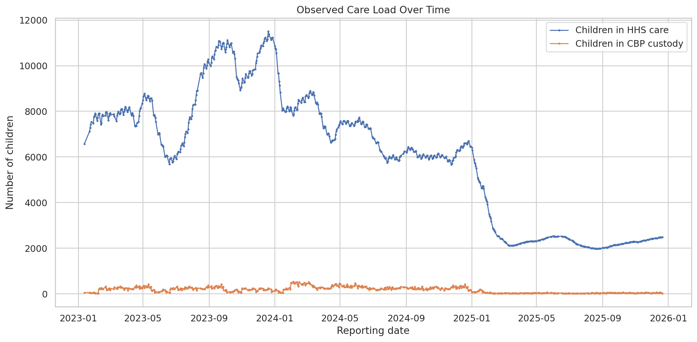
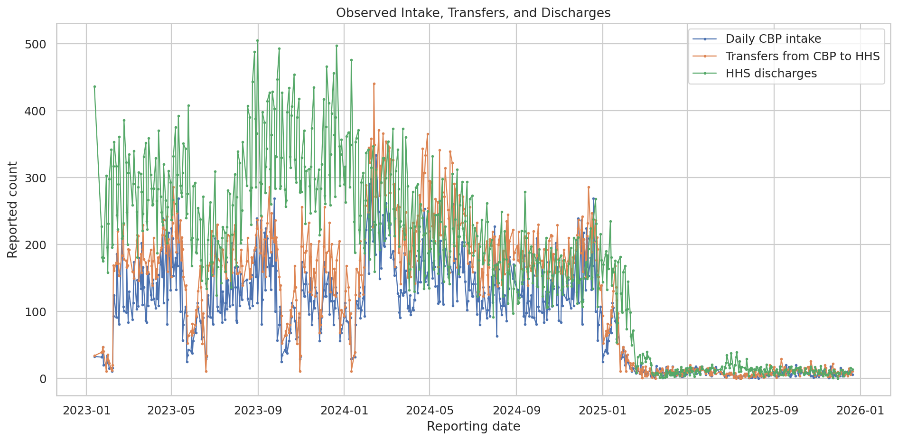
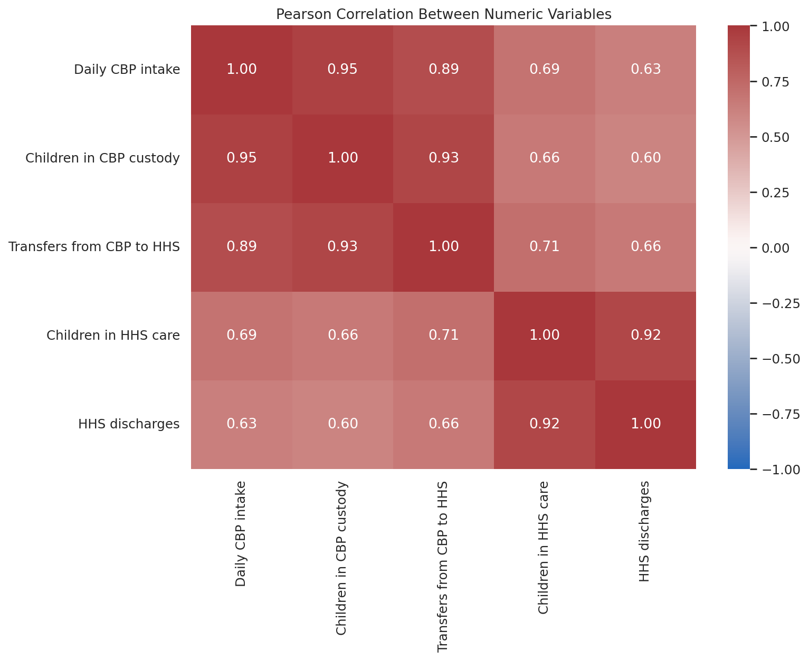
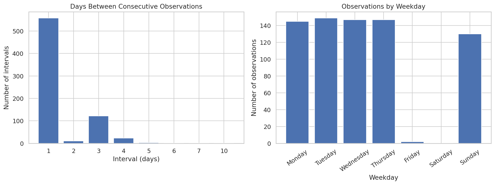
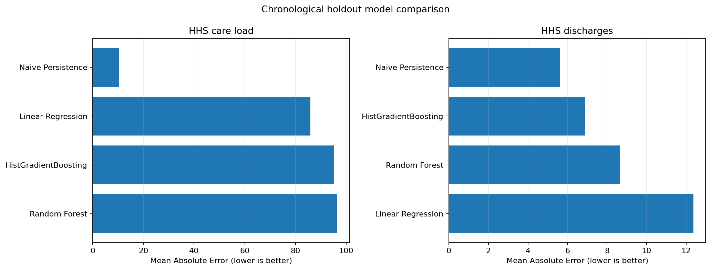

# Predictive Forecasting of Care Load & Placement Demand
## Final Research Report
**Project domain:** Data Science · Time-Series Analysis · Forecasting · Streamlit
**Dataset:** HHS Unaccompanied Alien Children Program
**Data coverage:** 12 January 2023 – 21 December 2025

## Abstract
This project investigates historical operational indicators from the U.S. Department of Health and Human Services (HHS) Unaccompanied Alien Children Program and develops a reproducible workflow for analysing care load and discharge activity. The workflow includes data validation, exploratory data analysis, feature engineering, baseline and machine-learning forecasting, time-aware validation, uncertainty context, risk indicators, model comparison, and an interactive Streamlit dashboard. The dataset contains 720 observations across six fields, but only 720 of 1,075 calendar dates in the covered range are observed. Missing calendar dates are retained as gaps rather than automatically imputed. In a chronological holdout experiment, naïve persistence produced the lowest MAE for both HHS care load and HHS discharges. This result supports the use of simple baselines and also highlights the difficulty of forecasting variable discharge counts. The dataset ends on 21 December 2025; therefore, forecasts produced from this snapshot are historical demonstrations and must not be presented as current operational estimates.

## 1. Introduction
Operational planning can benefit from understanding how care load and discharge activity change over time. Time-series analysis provides a structured way to describe historical patterns and test whether recent observations offer useful information about subsequent reports. This project applies data-science methods to an HHS public dataset and packages the workflow into reproducible Python modules and a Streamlit interface.

## 2. Problem statement
The project aims to analyse historical HHS care-load and discharge observations, assess the feasibility of forecasting these measures, compare statistical baselines with machine-learning models, and present results in a clear dashboard. A key challenge is that the observations do not cover every calendar day, which means a next-observation forecast cannot automatically be interpreted as a next-calendar-day forecast.

## 3. Objectives
- Inspect and validate the source dataset and its reporting cadence.
- Summarize trends, distributions, and relationships among operational variables.
- Create lagged, rolling, calendar, and change-based features without overwriting raw data.
- Compare baseline and machine-learning models using chronological evaluation.
- Generate forecast visualizations and descriptive risk-context indicators.
- Deliver a modular Streamlit dashboard and reproducible reports.
- Document uncertainty, data limitations, and responsible interpretation.

## 4. Dataset description
The supplied CSV is `HHS_Unaccompanied_Alien_Children_Program.csv`. It contains 720 rows and six columns. The data covers 12 January 2023 through 21 December 2025.

| Standardized field | Description |
|---|---|
| `date` | Date associated with the report. |
| `cbp_daily_intake` | Daily intake/apprehension measure in CBP custody. |
| `cbp_custody` | Children in CBP custody. |
| `transfers_from_cbp_to_hhs` | Children transferred from CBP custody to HHS. |
| `hhs_care_load` | Children in HHS care; primary level target. |
| `hhs_discharges` | Children discharged from HHS care; secondary target. |

## 5. Data preparation and quality
- Original and cleaned observed records: 720 and 720.
- Date range: 2023-01-12 to 2025-12-21.
- Unique observed dates: 720.
- Calendar days in the date range: 1075.
- Calendar dates without observations: 355.
- Duplicate date rows removed: 0.
- Missing cell values after cleaning: 0.
The care-load field was converted from comma-formatted text to numeric values. Dates were parsed and sorted chronologically. A separate calendar index makes unobserved dates visible. Missing calendar dates were not filled with synthetic values because the appropriate treatment depends on the reporting process and the meaning of the gaps.

## 6. Exploratory data analysis
- HHS care load: minimum 1,972, maximum 11,516, mean 6,061.3.
- HHS discharges: minimum 0, maximum 505, mean 173.4 per observed report.
Pearson correlations identify descriptive associations. The strongest pairs in this dataset include CBP daily intake and CBP custody (r ≈ 0.951), CBP custody and transfers (r ≈ 0.925), and HHS care load and HHS discharges (r ≈ 0.921). These relationships are not evidence of causation and may be influenced by shared trends or temporal structure.

### Selected EDA figures


Figure 1. Historical HHS care load.



Figure 2. Intake, transfers, and discharges.



Figure 3. Correlation heatmap.



Figure 4. Reporting-date pattern.

## 7. Feature engineering
The feature-engineering module creates lagged values, rolling means and standard deviations, calendar fields, elapsed days since the prior observation, and changes between observed reports. Rolling features are based on prior observed records. Because the data has calendar gaps, a lag of one means the previous observed report and not necessarily the previous calendar day. Features must only be used if they would be available at the forecast origin; target leakage must be checked for every intended horizon.

## 8. Forecasting methodology
The initial model comparison includes naïve persistence, linear regression, random forest, and histogram-based gradient boosting. Evaluation uses a chronological holdout, with 142 test observations from 18 May 2025 through 21 December 2025. Random shuffling is avoided. Rolling-origin validation is also included to examine stability across multiple chronological folds.

### Holdout performance
| Target | Model | MAE | RMSE | R² |
|---|---|---:|---:|---:|
| hhs_care_load | Naive Persistence | 10.42 | 14.21 | 0.993 |
| hhs_care_load | Linear Regression | 85.83 | 105.22 | 0.643 |
| hhs_care_load | HistGradientBoosting | 95.28 | 114.09 | 0.580 |
| hhs_care_load | Random Forest | 96.52 | 113.98 | 0.581 |
| hhs_discharges | Naive Persistence | 5.63 | 7.64 | -0.442 |
| hhs_discharges | HistGradientBoosting | 6.88 | 9.10 | -1.048 |
| hhs_discharges | Random Forest | 8.66 | 11.75 | -2.410 |
| hhs_discharges | Linear Regression | 12.37 | 14.27 | -4.035 |

Naïve persistence achieved the lowest holdout MAE for both targets. For care load, its MAE was approximately 10.42 and R² was 0.993 on the test observations. For discharges, its MAE was approximately 5.63, but R² was −0.442. A negative R² indicates performance worse than the test-set mean under the R² definition, even when absolute errors appear modest. MAPE is less suitable for discharges because zero or near-zero values can make percentage errors unstable.



Figure 5. Model comparison by MAE.

## 9. Forecast generation and uncertainty
The project generates 7-, 14-, and 30-calendar-day forecast tables using simple baseline strategies. These outputs demonstrate the workflow but are not evidence of validated multi-step calendar-day forecast skill. The current source ends on 21 December 2025, so generated forecast dates begin after that date and are not current as of the report preparation date. Empirical error bands based on out-of-fold errors are exploratory and are not guaranteed calibrated prediction intervals; they should not be interpreted as 90% coverage guarantees unless calibration has been verified for the relevant horizon.

## 10. Risk-context analysis
The risk module compares forecast values with historical percentiles, including the 75th and 90th percentiles, and flags cases where empirical upper bands approach historical high values. These are descriptive historical-context indicators only. The dataset does not include facility capacity, staffing availability, placement capacity, or operational thresholds, so the flags cannot be called capacity alerts or placement-demand thresholds.

## 11. Model explainability
Permutation importance is calculated for diagnostic machine-learning models to estimate how shuffling a feature changes model error. It describes the predictive usefulness of features for those models; it does not establish causality and does not explain the naïve persistence model. Correlated features can divide or obscure importance, so results should be interpreted alongside domain knowledge and time-aware validation.

## 12. Application and reproducibility
The Streamlit application presents historical KPIs, forecast plots, forecast tables, downloads, and risk-context indicators. The project is organized into modules under `src/`, with raw data, processed data, figures, and reports kept separately.

```bash
pip install -r requirements.txt
python -m src.data_preparation
python -m src.eda
python -m src.feature_engineering
python -m src.forecasting
python -m src.validation
python -m src.forecast_generation
python -m src.forecast_visualization
python -m src.risk_analysis
python -m src.model_explainability
python -m src.automated_insights
streamlit run app.py
```

## 13. Conclusions
This project demonstrates a complete, modular workflow for time-series data analysis, forecasting experiments, uncertainty context, and dashboard reporting. The principal empirical finding is that naïve persistence outperformed the tested machine-learning alternatives on the current holdout. The discharge target remains difficult to forecast reliably. The most important data issue is incomplete calendar coverage: 355 calendar dates in the source interval have no observation. Preserving these gaps avoids silently inventing data, but it also limits the interpretation of forecasts as calendar-day predictions.

## 14. Recommendations and future work
- Acquire the latest official data snapshot and record its retrieval date.
- Confirm the reporting schedule and reasons for missing dates with the data provider.
- Define the target horizon explicitly as next report, next calendar day, or multi-day cumulative demand.
- Use rolling-origin evaluation separately for every target and forecast horizon.
- Develop horizon-aware models only after aligning the data to a defensible calendar and resolving missingness.
- Compare prediction intervals using empirical coverage and width on held-out future periods.
- Obtain authoritative capacity and staffing data before creating operational capacity alerts.
- Review feature availability at forecast time to prevent leakage.
- Treat the dashboard as decision support, not as a substitute for operational judgement.

## 15. Limitations and responsible use
- The source ends on 2025-12-21; forecasts from this snapshot are not current operational estimates.
- There are missing calendar dates. They were not imputed, and a next-observation forecast is not equivalent to a next-calendar-day forecast.
- Pearson correlations are descriptive and do not imply causation; time trends and correlated variables may affect them.
- Historical percentile risk flags are not capacity alerts because facility capacity and staffing thresholds are not provided.
- Empirical error bands are not guaranteed prediction intervals and should not be interpreted as calibrated coverage guarantees.
- This analysis concerns aggregate program-level data and should not be used to infer individual-level outcomes.

## References
1. U.S. Department of Health and Human Services. *HHS Unaccompanied Alien Children Program* dataset. Data.gov catalogue: https://catalog.data.gov/dataset/hhs-unaccompanied-alien-children-program
2. scikit-learn documentation. *Time-related feature engineering and evaluation considerations* and model evaluation metrics: https://scikit-learn.org/stable/modules/model_evaluation.html
3. pandas documentation. *Time series / date functionality*: https://pandas.pydata.org/docs/user_guide/timeseries.html
4. Streamlit documentation. *Build and run Streamlit apps*: https://docs.streamlit.io/

---
**Reproducibility note:** All numerical findings in this report are based on the supplied CSV snapshot and the generated project outputs included with this submission. Update the data and rerun the pipeline before making current operational claims.